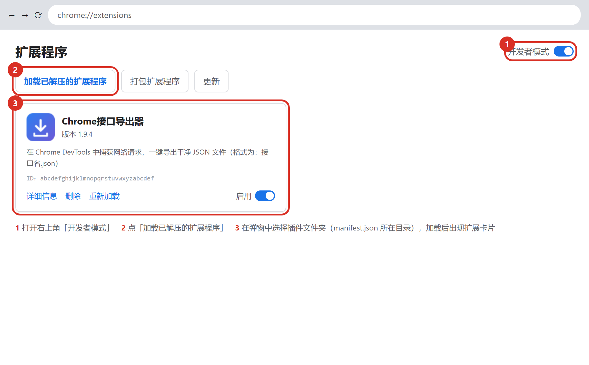
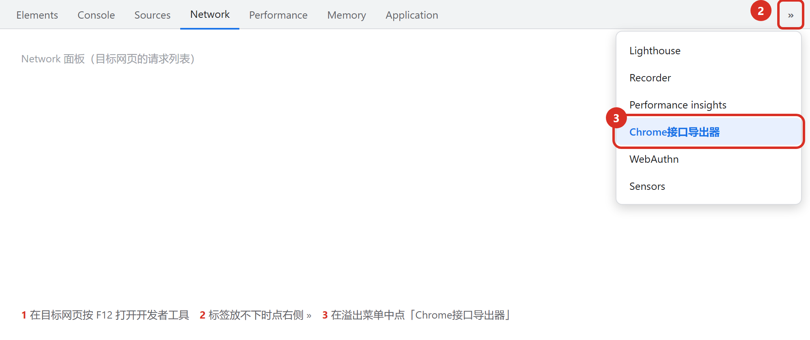
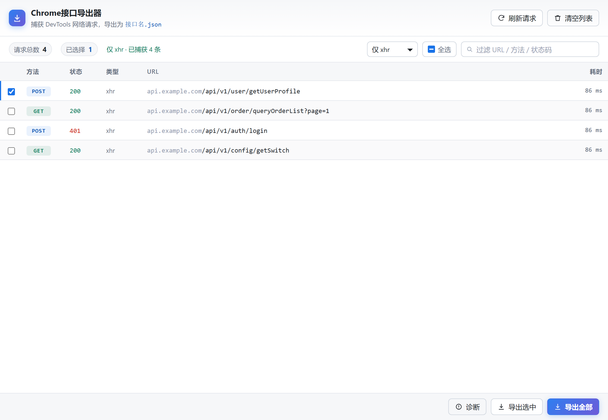
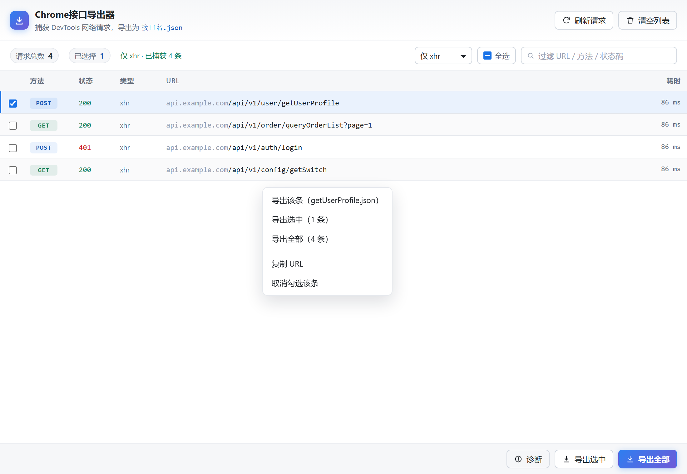
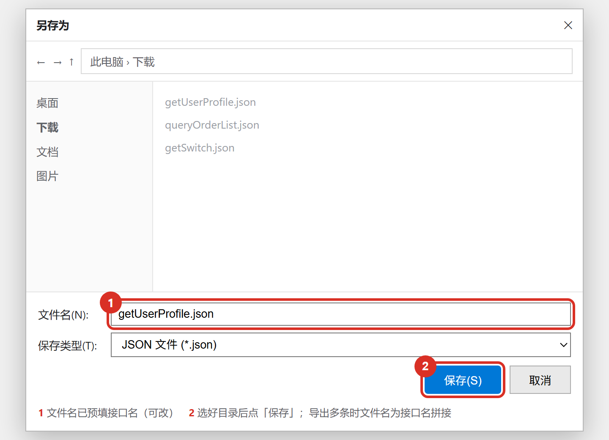

# Chrome接口导出器

在 DevTools 里捕获接口请求，一键导出成**干净的接口 JSON**，文件名就是接口名（`getUserProfile.json`）。

## 功能
- 在 Chrome DevTools 中监听网络请求，请求完成后立即进入列表，响应正文异步补充（`getContent` 慢或失败都不影响列表）。
- **只导出一种格式：接口 JSON**。内容仅含接口名、URL、方法、状态码、业务请求头、请求体、响应体。
- **文件名 = 接口名.json**：取 URL 路径最后一段，如 `/api/v1/user/getUserProfile` → `getUserProfile.json`。
- **类型过滤三档，默认「仅 xhr」**：image / stylesheet / script 等静态资源默认不展示；可切「fetch + xhr」或「全部类型」，点「刷新请求」回读 Network 历史。
- **深浅色自适应**：面板跟随 DevTools 主题（`chrome.devtools.panels.themeName`）自动切换；方法/状态码用颜色区分（GET 绿、POST 蓝、4xx 红）。
- 列表支持关键词过滤（URL / 方法 / 状态码）、单条勾选、全选当前过滤结果、**点击行任意位置即可勾选**；新请求进来不会丢已有勾选。
- **右键请求行**：导出该条 / 导出选中 / 导出全部 / 复制 URL / 勾选切换；右键未勾选的行会自动勾选。
- 导出弹出**另存为对话框**，文件名预填接口名，保存位置自选；下载通道按「系统另存为 → chrome.downloads → 后台 worker → 浏览器兜底」逐级降级，后台还会用 `onDeterminingFilename` 把兜底下载的文件名改回接口名。
- 底栏**「诊断」按钮**：一键查看 `chrome.downloads` / `showSaveFilePicker` / 后台 worker 是否可用，以及上次导出走的通道和每一级失败原因，可复制。

## 安装（开发者模式）
1. 解压 ZIP 到固定目录（安装后不要移动或删除该目录）。
2. Chrome 地址栏打开 `chrome://extensions/`。
3. 打开右上角「开发者模式」。
4. 点「加载已解压的扩展程序」，选择解压后的 `chrome-api-exporter-v1.0.0` 文件夹。



*示意图：① 打开右上角「开发者模式」；② 点「加载已解压的扩展程序」；③ 选择插件文件夹后出现扩展卡片。*

5. **如果之前已经开着 DevTools，必须先完全关闭 DevTools 再重新按 F12 打开**——扩展面板只在 DevTools 启动时注册，这是「装了没生效」的最常见原因。
6. 在 DevTools 顶部标签中找到 `Chrome接口导出器`（标签多时可能藏在 `»` 溢出菜单里）。



*示意图：① 在目标网页按 F12 打开开发者工具；② 标签放不下时点右侧 `»`；③ 在溢出菜单中点「Chrome接口导出器」。*

7. 打开面板后刷新目标网页或执行操作产生请求；也可点「刷新请求」读取 Network 面板已有的请求。

## 捕获与导出
### 勾选请求
请求完成后立即出现在列表中；点击行任意位置或行首复选框勾选，「全选」作用于当前过滤结果。顶栏实时显示请求总数与已选择条数。



*面板示例（示例数据）：勾选 `getUserProfile` 行，行左侧出现强调条，「已选择」计数同步更新。*

### 右键菜单
在请求行上右键：导出该条 / 导出选中 / 导出全部 / 复制 URL / 取消勾选该条。右键未勾选的行会自动勾选，保证「导出选中」包含它。



*右键菜单示例（示例数据）：菜单第一项直接预告落盘文件名 `getUserProfile.json`。*

### 另存为
点「导出选中 / 导出全部」或右键菜单中的导出项，弹出另存为对话框：文件名已预填接口名，可改；选好目录后点「保存」。



*示意图：① 文件名已预填接口名（可改）；② 选好目录后点「保存」。导出多条时文件名为接口名拼接。*

## 导出说明
导出内容（单条为对象，多条为数组）：

```json
{
  "interface": "getUserProfile",
  "url": "https://api.example.com/api/v1/user/getUserProfile",
  "method": "POST",
  "status": 200,
  "requestHeaders": { "Content-Type": "application/json" },
  "request": { "userId": "10001" },
  "response": { "code": 0, "data": { "nickname": "示例用户" }, "msg": "ok" }
}
```

- 请求体 / 响应体为 JSON 时解析成对象，base64 正文自动解码，非 JSON 保留原文；读不到正文时为 `null`。
- 请求头只保留业务头（Content-Type、Cookie、Authorization、自定义头等），过滤 `:authority` 等 HTTP/2 伪头与 `sec-ch-ua` / `sec-fetch-*` / `user-agent` / `accept-encoding` 等浏览器自动附加头。
- 文件名规则：单条 → `接口名.json`；多条同接口 → `接口名.json`；多个接口 → `接口名A+接口名B+接口名C.json`，超过 3 个追加 `等N个接口`。
- 敏感字段（Cookie、Authorization、Token、密码）会出现在请求头中，分享前请脱敏。

## 正文与浏览器限制
Chrome DevTools `getContent()` 能否提供响应正文取决于 Network 缓存、资源类型、跨域策略与浏览器版本。请求正文来自 HAR 的 `postData`。文件上传、二进制流、流式响应、超大响应、未被 DevTools 保留的正文可能不完整；正文读取失败不影响请求出现在列表中。

## 排障
- **看不到面板**：确认扩展已启用且无报错（`chrome://extensions/` 卡片上若显示「错误」按钮，点开查看）；**完全关闭 DevTools 后重新打开**；在 DevTools 标签栏 `»` 溢出菜单里找 `Chrome接口导出器`。
- **面板显示「未检测到 DevTools 环境」**：面板页面没有在 DevTools 里运行，关闭后重新按 F12 打开。
- **没有请求**：先打开本扩展面板，再刷新目标网页；`chrome://`、Chrome 商店等内部页面无法抓包，请换普通 http/https 网站；确认 Network 面板本身能看到请求。
- **列表里只有静态资源**：默认「仅 xhr」已过滤；接口是 fetch 类型时切到「fetch + xhr」档；document 类型的整页请求不算接口。
- **导出没反应或文件名仍是「下载.json」**：说明浏览器里跑的还是旧版扩展（后台 service worker 未注册）。到 `chrome://extensions/` 点本扩展「重新加载」，再完全关闭 DevTools 重开；仍异常时点底栏「诊断」查看通道与失败原因。

## 文件结构
- `manifest.json`：Manifest V3 配置（版本号写在这里）
- `background.js`：后台 service worker，承接面板下载请求（`chrome.downloads` + 另存为 + 接口名）
- `devtools.html` / `devtools.js`：注册 DevTools 面板（含标签图标）
- `icons/`：自绘扩展图标 16 / 32 / 48 / 128 px
- `panel.html` / `panel.css` / `panel.js`：抓包列表、深浅色主题与导出逻辑
- `docs/images/`：本文档配图（接口与数据均为示例占位；安装 / 溢出菜单 / 另存为为操作示意图）
- `.gitignore`：发布到 GitHub 时排除本机调试文件